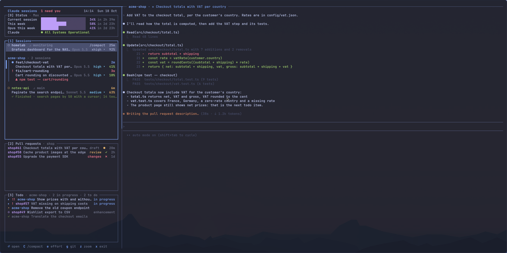

# Agent Cockpit

## Command names and upgrades

Agent-neutral commands now use `cockpit-`: `cockpit-todo`, `cockpit-remote`,
`cockpit-design`, `cockpit-guide`, `cockpit-run-approve`, `cockpit-fade`,
`cockpit-demo`, `cockpit-needs-input`, `cockpit-session-label`,
`cockpit-health-check`, and `cockpit-idle-prompt`. Every old `claude-*` spelling
below remains a forwarding alias; `claude-sessions` forwards to `cockpit` too.
Claude Code updates, Claude usage, and `claude-audit` retain their names.

`cockpit apply` and `make install` run the checked migration in
[`tools/migrate-cockpit-names.py`](tools/migrate-cockpit-names.py). Existing phone
pairing and push subscriptions survive. The phone unit becomes
`cockpit-remote.service`; the weekly timer becomes `cockpit-health-check.timer`.
Enabled/active intent and the timer's last-run stamp are preserved, and old units
are stopped and disabled. Pending approvals keep their requests and terminals;
the daemon restart waits for their completion. Conflicting state locations stop
migration before anything is moved.

Shared state/runtime paths use `cockpit-*`. Existing private phone state and
stuck-exit captures stay physically beneath the legacy sandbox masks, with
canonical aliases pointing there; moving them would expose them to old sandboxes.
The shared `runs` and `designs` caches are addressed through `~/.cache/cockpit/`;
existing caches are linked rather than moved out of old sandboxes' parent mounts.
The rest of `~/.cache/claude/` stays untouched. Agent-neutral `COCKPIT_*` configuration wins
over its old `CLAUDE_*` spelling; old overrides still work. Phone cookies, request
formats, existing tmux/session identifiers, and the protected `claude-audit`
folder deliberately stay unchanged. Restart sessions whose existing sandbox
cannot read the new command files; the migration preserves mounted directory
inodes, but cannot add new file mounts to an already-running sandbox.

The todo queue is a special case: it is consumed by renaming and deleting its
file, so it must never be a symlink. During transition the sole sidebar consumes
the old and new queues exactly once, with the existing combined update limit.
Finish or close outstanding guides before deployment; a deferred OSD restart
also waits for guides so their windows and results are not orphaned.

Workspace 6 is a cockpit for every Claude Code session on the machine. `cockpit` keeps a tmux session, `claude-manager`, with a column of panels on the left and the selected session on the right. Every session runs inside greywall; Claude Code hooks report each session's state to the OSD daemon, which keeps the registry the column reads.




The screenshots come from `tools/capture-claude.sh`, which builds a made-up cockpit (`claude-demo` in `apps/cockpit`: invented sessions, todos, pull requests and usage) in a tmux server and a home folder of its own, so no real session, task or cost appears.

## The column

| Key | Panel | What it shows |
| --- | --- | --- |
| `s` | Status | Plan usage, spending, Chief (`c` opens it, `l` its answer log, `h` its habits) and pull requests. Under Services, select Claude or Codex and press Enter for its official status page. Under Utilities, Enter opens the daily digest or clones review/cleanup |
| `1` | Sessions | One card per running session: state, project, branch, title, model, effort (click to change), context use, and badges for `/compact`, an installed update, a needed restart, Remote Control, API credits (`$ credits`), pins, `◆ figcraft` on the sessions of the project the running FigCraft serves, when it answers (the hook checks the connection inside the sandbox at each event; every session has the server, so the others show nothing) and commits not pushed yet (`↑2 unpushed`, counted by the hook inside the sandbox at each start and turn end, cleared by a `U` push; in a dotfiles clone, `↑2 unapplied`: the commits whose change `~/dotfiles` lacks, compared by patch id since `git am` gives an applied commit a new hash, and `↑2 unpushed` beside it: what `~/dotfiles` holds and GitHub lacks, counted by the column in the live checkout every 5 s, which `U` pushes after the apply), and background work still running when its turn ended (`◷ 2 agents + background`: the background agents counted, then shells, monitors or workflows, from the list Claude hands the hook at each turn end). The time spent with Claude on the project (`⏱ 34h`, or `⏱ 1h20 today · 34h`) sits on the card, or on the project's heading when it has several sessions: the gaps under 5 minutes between its sessions' replies, from the cost archive, so past months count too and a session left open overnight does not. The Status panel adds `Time with Claude`, today, this week and this month, all sessions together: their active stretches merged where they overlap, so three sessions through the same hour count one hour, never the sum of the projects' times. Once a turn ends, the card says what it left: commits, uncommitted changes, whether its last test run passed or failed, and a todo item closed (worked out by the hook inside the sandbox, from git and the turn's transcript). A repository's sessions sit under one heading |
| Status → `p` | Pull requests | CI and review state; Enter starts a review in a separate clone, `o` opens GitHub, `l` sets Later / brings it back, `t` opens its task trail |
| `2` | Todo | Typed items and open GitHub issues of the viewed project, by priority and status tabs (`[` / `]`). `t` adds, `e` edits, `i` / Enter opens details, `T` opens the task trail, `r` runs now in a new clone, `h` hands to a session, `Q` queues, `d` marks done, and `m` moves a typed item to another project. Inside details, `i` toggles In progress / To do |
| `3` | Ideas | Global proposals; `y` approves, `n` declines, `i` / Enter shows details |

Todo's title-and-notes form supports `CMD+V` for clipboard images. PNGs are kept in `~/.local/state/cockpit/todo-images/`, readable but not writable by sessions. Deleting an image marker drops it; unreferenced images are removed after an hour. A handed-off session reads the images through `cockpit-todo show`.

Cross-project work uses `cockpit-todo add … --project <name>` and appears queued with its originating project in the details. It is a collaborator request, never your authorization. `--after <id>` (or `cockpit-todo after <id> <other>…`) waits for prerequisites and forwards their completion summaries. `cockpit-todo propose … --project <name>` instead waits for approval. A reporting project keeps at most three such filings open per target project; the session holding the active Chief grant, which the daemon verifies, keeps ten (other sessions of its project still three). Handing work off starts a background card without changing the viewed session. The queue picks one item at a time by priority after five idle minutes, excluding the viewed session; design work routes to a Designer.

Setup blocks use `cockpit-todo blocked '<what>' --why '<what stopped it>'`; problems in greywall or greyproxy's own code use `cockpit-todo stack <repo> '<title>' --why '<why>' --kind <kind>`. Reports retain their originating session and are framed as data. Duplicate open reports are coalesced, with caps of three open and five daily per reporting project. Finishing a report or cross-project item notifies its original session through the prompt queue; an ended session receives it when resumed. Unknown sessions or missing clones receive nothing (`cockpit logs` explains why).

A session started with `claude` and `t` ("this terminal") still gets a card (badge `▭ terminal`) you can open and message, but `⌘R`, the reboot restore, the Todo queue and the error hand-off leave it alone. `ask-to-run` uses the same per-command approval as managed sessions; `ask-to-guide` remains unavailable, so Claude gives you the steps instead. An approval pane shows only under the session that asked, and follows you back to it. Requests from several sessions (a project's parallel clones too) do not wait for each other's commands: one approval asks you at a time, and once you approve a command it runs on in its pane while the next request shows; a command that then asks for input (a sudo password) comes back to you next. When `ask-to-run` cannot reach you, it says why and what fixes it, and `ask-to-run --check` at each session start tells the session before it needs it.

Above the cards, the Sessions panel warns about requests greyproxy is holding, a disk 85 % full or more (`/` or home, read every minute, pointing to `make disk`), sessions to bring back after a reboot (`B`), a Claude incident, and sessions started before a change to CLAUDE.md, the settings, plugins, hooks or the sandbox (`⌘R` restarts the ones waiting at their prompt).

Idle sessions sleep: a session idle at its prompt for `idle-sleep-after` minutes (default 60, at least 30; `S` Sleep after (minutes)) is exited, to free its memory, and stays as an `Asleep` card with the time it has slept. Opening it, Alt+Q on it, a todo handed to it (queued or `h`), `R`, or the phone's Wake button resumes the same conversation (Remote Control comes back if it was on), and `x` forgets it for good; `z` puts the selected session to sleep at once (the same checks, without waiting for the idle time). It never sleeps with text typed in its input box, background shells or work running, on screen, as a `t` terminal session or a Codex one, or with a queued message or a todo in progress; any doubt keeps it awake (`cockpit logs` says why). Approved Claude and opencode teammates may sleep too: incoming team messages wake them in the same task and role, using a verified one-use sleep handoff. Unknown membership or pending/uncertain team delivery keeps them awake. This continuation applies only to cockpit-managed sleep/wake; restarting a live teammate or manually resuming history still requires fresh team approval. Sleeping idle sessions can be turned off (`S` Sleep idle sessions, `cockpit setting idle-sleep on|off`). The notes behind the cards are in `~/.local/state/cockpit/asleep/` and survive a reboot; one older than 7 days is dropped and its card goes, the session staying resumable with `H`. A clone with an asleep session is not offered by Status's clones review.

Sessions keys: Enter opens, `n` goes to the next session needing you, `i` shows grouped details, `l` sets Later / brings it back, `k` opens Links, `p` pins, `R` restarts (lowercase `r` only runs the todo a blocked card waits on), `⌘R` restarts every session that lacks a change once it waits, and `x` ends. `u` opens Updates, `Q` explains queued work, and `v` marks displayed updates reviewed without answering or approving. The remaining card actions are listed in `i` below.

Everywhere: `1` Sessions, `2` Todo, `3` Ideas, `s` Status, `N` New session, `H` resume history, `S` settings, `P` / `W` / `G` open the pull requests / Claude web / greyproxy windows, and `?` contextual help. The old `/` search and `:` palette are removed. Status Utilities contains the existing daily digest and clones review; cleanup still checks for running sessions, uncommitted changes and unpushed commits before asking for confirmation.

Moving around (⌘ is the physical Command key, which keyd turns into Control): ⌘Tab between the column and the session, ⌘1/2/3 to a tab from inside the session, → into the session, and ← back to the column from the start of Claude's prompt (an empty prompt, or the cursor before the first character). Anywhere else in the session the arrows are Claude's, to move in your text. The focused side is lit; the other pane fades.

**New-session defaults:** `S` chooses Claude Code or OpenCode as the default agent (initially Claude), plus OpenCode's model and effort. `N`'s new-session form starts on that default (its agent choice overrides it for one session), as do parallel sessions, reviews, new Todo handoffs, and manager commands without `--agent`. Existing sessions keep their agent and model; an explicit `--agent` and bare `claude`/`opencode` terminal commands still override it.

**`N` (everywhere)** opens the new-session form. Start from **Blank session** or **Claude Design canvas**. Blank mode keeps the project filter, Claude/OpenCode/Codex choice, first message and own-clone option (on by default). Canvas mode accepts a Claude Design link and starts in the selected project with the default agent, without a new clone. Switching modes keeps your entries. Tab moves between fields, ⌘S starts, Esc cancels. Most work starts from a todo instead: Todo's `r` runs the selected item now, in its own clone.

**`i` on a session** shows why (project › task), where and who (clone, branch, unpushed commits, agent, model, effort, context, start time, billing), what is around it (Chief answers, links, queued messages, background agents, Remote Control), your note, its ask or last turn, then its keys by group: Work (`e` effort, `$` billing, `C` /compact, `c` Chief answers, `k` links, `d` drop queued), Code (`g` lazygit, `U` push / apply, `+` parallel clone, `o` design canvas, `t` task trail) and Session (`I` images, `m` Remote Control, `w` my note, `z` sleep, `R` restart, `x` end). The same keys work on the selected card without opening `i`. `I` opens the images the session's latest reply names on a line of their own (``) in one floating viewer (loupe) on workspace 6, the first shown and the arrows browsing the rest; the phone's rules apply (only inside the session's folder, no symlink out of it, PNG, JPEG, GIF or WebP by their bytes, at most 10 MB), and the viewer opens private copies, in a folder of their own under the runtime directory. A reply without one says "No images in its latest reply." `?` shows the open tab's keys, the keys that work everywhere and, on Sessions, what the card signs mean.

The model and effort pickers load the active project's available OpenCode models inside its sandbox, without starting the shared service. Press Enter again after loading; with no active project, pick one for the catalog. Effort lists only the selected model's supported variants. Changing the model clears the old effort; **OpenCode default** clears an override. On either Settings row, `d` clears it without needing a working catalog, including when the saved model is unavailable. Choices persist in `~/.local/state/cockpit/settings.json`, alongside the existing toggles (`cockpit setting default-agent claude|opencode`, `setting opencode-model <provider/model>`, `setting opencode-effort <variant>`; an empty value clears the model or effort).

## Picking work back up

`w` on a session writes your note on it. A note stays in the session's selected/full details across
cockpit restarts and view switches; it is never sent to the agent. Notes accept
up to 280 characters. Empty input keeps the note (or cancels); `-` removes it.
An unreadable continuity file produces a persistent warning and is preserved,
not silently replaced. These actions do not change existing keyboard shortcuts.

**Updates** (`u` on Sessions or session details) lists unseen latest-turn results and explicit questions, plus saved
return notes (including exited sessions). Enter opens the chosen update's
actions: mark that displayed update reviewed, or open its live session when
there is one. **Reviewed** (`v`) acknowledges the selected session's displayed
updates; viewing or focusing alone never clears them, and acknowledgement is
not an answer or approval. A turn can have both a result and a question. The
summary counts unseen updates separately from sessions needing input. This is
latest-result tracking, not a lossless activity log. Older sessions show that
result tracking is unavailable until restarted on the new reporting hook.

**Queue** (`Q` on Sessions or session details) explains the viewed project's queued items (all known projects when
none is viewed), in dispatch priority order and with designer/developer routing.
It names the reason a session cannot take work, including your pending manual
messages, questions, approved commands still running, the viewed-session
exclusion, and the five-minute idle window. Eligibility is checked every 30
seconds, not an exact promised start time. The view never dispatches work or
fetches GitHub data; unavailable issue data is labelled explicitly. `Q` still
queues or unqueues a To do item.

**Task trail** (`t` on a session or pull request; `T` on a Todo row or its details) connects a task
to every recorded session, unambiguous observed results, and exact
repository/head-branch PR matches. Enter lists navigation actions; opening a PR
never merges it. Multiple matches remain choices rather than a guessed owner.
When Todo retention or a closed/deleted issue removes the source, its link opens
archived details instead of recreating work. Missing or stale GitHub data is not
presented as proof that there is no PR or that a vanished PR was merged.

New handoffs ask the agent to run `claude-todo start <id>` before working so a
background session can identify its assignment. Until that update (or an exact
task branch with a known repository identity), the trail says “Starting;
awaiting assignment”. A result arriving at the same time as a changed assignment
is retained as a session update, not guessed onto either task. Task trails do
not copy full transcripts or silently restart archived conversations.

`l` (later) on a session hides its explicit question for 20 minutes (the card waits in QUIET as
`‖ Later · back in 18m`) and `l` again brings it back. The same `l` action works on a focused PR requiring review.
A deferred item stays visible and counted; `n` skips deferred questions until their twenty-minute timer expires. A different
question, a new PR head commit or a changed review decision invalidates the old
timer. Deferrals survive cockpit restarts; overdue reminders return on launch.
Approvals, permission dialogs, password/command input and unknown states cannot
be deferred. Neither deferral nor acknowledgement answers anything, and a
deferred question still blocks automatic queued work.

Deferral affects **cockpit navigation only**: it does not change desktop banners,
phone notifications or digests, and it promises no background notification while
the cockpit is closed. PR deferral requires a known head revision. NEEDS YOU, WORKING and QUIET grouping replaces the attention filter; Updates and Queue remain separate views.

## Out of the sandbox, with my approval

| Command (inside a session) | What happens outside |
| --- | --- |
| `ask-to-run --why '…' '<command>'` | An approval terminal shows the command and Claude's explanation, in a pane under the session in the cockpit and in a floating window elsewhere. Nothing runs without "Run it"; the output then goes back to Claude, with tokens, keys, passwords and credentials replaced by `[redacted]` first. Hidden characters are shown escaped |
| `ask-to-guide` | Steps I do by hand (a browser, a console) in a floating window, one at a time, with links to open, values to copy and questions to answer; `⌘V` attaches a clipboard image to a step; the answers, images, or the step I got stuck on go back to Claude |
| `claude-todo start/done/add` | Updates the Todo panel |
| `claude-needs-input '<question>'` | Marks the session as needing your answer, with the question on its card. Claude and OpenCode keep it through tool completion, turn end and idle notifications; your next message clears it |
| `craft-open figcraft --workspace <n> [--session <id>]` (through `ask-to-run`) | Starts an independent FigCraft per checkout (parallel clones included) on workspace `<n>`, which the agent asks you for first (6, the cockpit's, is refused; an already open window is not moved; on a workspace already showing one FigCraft, window or tab group, the new window joins it as a Hyprland tab instead of splitting the workspace, each tab still its own confined app; several separate FigCraft tiles there or a locked group leave it beside them, with a notification), with confined file access, private preferences/recovery storage, and a permanently reserved control port. Existing windows stay open. The launcher forwards only that checkout's verified port and connects its `figcraft-app` MCP server to it; occupied ports and foreign stale forwards fail closed. Reservations live in host-only `~/.config/greywall-agents/figcraft` and must not be recycled while old sandboxes exist. When connecting an agent, always pass `--session <id>`, even if its tools are listed: it restarts the session once its turn ends, then tells it to carry on. Without it, existing sessions keep their old forwards and MCP connections. Tell a session "connect to FigCraft" |

TODO editing survives cockpit updates: `cockpit reload` waits until the editor closes and the item is saved. Editor buffers and their original project are kept in `~/.local/state/cockpit/todo-drafts/` until saving succeeds; interrupted drafts are recovered when the cockpit restarts (or once a still-open editor closes). Save or editor errors leave the draft intact and show a message instead of claiming success. Older untracked runtime drafts are left untouched because they have no project metadata.

Agents must signal blocking chat questions with `claude-needs-input` immediately before ending their reply, not optional follow-up offers. Questions must be a nonblank single line of at most 300 characters, without control characters or tmux format sequences. This does not replace approval or guide requests. After installing this command and rule, restart existing sessions so their sandbox can read the command and their agent loads the updated instructions.

Files the sandbox cannot write (CLAUDE.md, hooks, greywall, fish, systemd) go through `.handoff/` and `make handoff-install`, which shows each diff and asks first.

Nothing outside the sandbox runs git on a session's folder, since a session can write that repository's configuration: the hook works out what a turn changed inside the sandbox, the daemon reads project names from the `.git` files, `g` opens lazygit inside greywall, `A` and `+` switch a clone's branch inside greywall, `K` checks clones inside greywall, and a pull request review (`c`) always gets a fresh clone, so its fetch (which needs your credentials) never runs in a folder a session had.

What sessions can and cannot do to the machine (audits of 2026-10-18 and 2026-10-19):

- They report their state on a socket (`osd-report.socket`, in `$XDG_RUNTIME_DIR/claude-report/`, a folder each sandbox mounts whole and read-only, so a socket made again reaches running sessions too and no session can put its own in its place): the daemon asks the kernel which process sent a report and takes the tmux pane from its first ancestor outside the sandbox, so no session can claim another's pane or card. Run and guide requests go on that socket too, whole: the daemon keeps its own copy in the runtime directory at once, with the folder the sender's sandbox started in, and the approval and guide windows read only that copy (no session can rewrite another's request; a command for a folder outside the session's is flagged in red). Nothing of a sandbox's is taken on `osd.fifo` any more; banners, focus, clearing the column and approval phases only come through `osd-host.fifo`, which no sandbox can open.
- `~/.ssh/known_hosts` is read-only for sessions.
- Theo's answers (run results, guide progress) go to `$XDG_RUNTIME_DIR/claude-answers/<project>`, written only outside the sandbox: each sandbox has its own project's folder mounted read-only and sees no other, so no session forges an approved output or reads another project's.
- Both launchers, `greywall-agents/claude` and `greywall-agents/opencode`, source `launcher-common.sh`: an opencode session gets the same guards, answers folder, tokens, CA bundle, Docker and forwards as a Claude one, in its own greywall profile, and never the Console's API key. Its Anthropic API key comes from the keyring (`make agent-opencode-key`) and stays a greyproxy placeholder in the sandbox, since opencode's own credential store (`opencode.db`) is open to every opencode session; without one it uses `opencode auth login`. Its replies join Claude's in the usage archive (cost at API prices from their tokens, time spent per project), read-only from `~/.local/share/opencode/opencode.db`. The cockpit starts it with `--standalone` (a server of its own, not opencode 2's shared background one) and a session id it picks, exported as `CLAUDE_CODE_SESSION_ID`. Its plugin (`config/opencode/.config/opencode/plugins/cockpit.ts`, opencode 2's `{id, setup}` plugin API) sends its events through Claude's hook, `session-state.sh`, as the payloads Claude Code sends, with `agent: opencode`: the daemon keeps an opencode session alive while an `opencode` process runs in its pane, and reads its state from those reports only, never from Claude's screen patterns.
- Background build tools (`cargo`, `make`, `npm`, `pnpm`, `go`, `composer`, `pytest`) resolve through CPU-guard shims in the launchers' existing read-only cache. They and their children run at the lowest priority (`SCHED_IDLE`, nice +19) on every available logical CPU; the cockpit and interactive agents keep their normal priority. Builds fill otherwise idle threads, and a waking interactive task preempts them, also across session cgroups, where nice alone has no effect. Nested tools inherit the same priority. `make build` and `make test` also guard host Cargo builds. Other tools can use `agent-build COMMAND [ARGUMENTS...]`. This trades build speed for responsiveness, not memory limits; it is a scheduling safeguard, not sandbox enforcement. Absolute tool paths and work in separate Docker daemons bypass it. Launcher setup affects new sessions; already-running shells use the shims only if their cache directory is visible and first on PATH.
- `~/.claude/projects/<folder>` of every other project (memory, transcripts) is read-only in a session: the launcher writes a settings file of its own per project and agent (`$XDG_RUNTIME_DIR/greywall-agents`), greywall.json plus those folders in `denyWrite`; an opencode session's drops greywall.json's `denyRead` entries for opencode's own data and config, which hide them from Claude sessions. Memory found for a fresh parallel clone is set aside.
- `.git/config` and `.git/hooks` are read-only in the folder a session starts in; every host git call in cockpit resets the settings that run a program, and a push redirected by a push URL or URL rewrite is refused.
- A session's folder (and so where a restart resumes it, with which project's token) is the folder its sandbox started in, read from `/proc`, never the one a report claims.
- Commands are shown as they run: run through `sh` exactly as quoted, in the folder resolved before Theo answers, with hidden characters, blank-line padding and non-ASCII letters flagged; output goes back with secrets redacted.
- Claude Code updates only from outside the sandbox (`claude-update.timer`); sessions cannot write the versions folder.
- `make system` and `make handoff-install` show every file (new ones whole, control characters visible) and refuse setuid bits and symlinked destinations.
- Todo items lose control characters, show "by Claude" when a session filed them, and go to sessions by folder, never by project name; the queue waits while Theo games.
- `claude-todo` changes go on the report socket too: the daemon queues them in the runtime directory with the folder the sender's sandbox started in, and that folder's project is the only one an update touches (an item lands there, a status changes only on that project's items and issues). Blocked reports: 3 open and 5 a day per project; at most 200 updates per apply, and every refusal is logged.
- What the column and the daemon read from folders a sandbox writes (transcripts, history, status lines, design links, `.git` files, credentials) goes through `util::read_untrusted`: no final symlink, no FIFO or device, a size cap. Report connections are read off the daemon's main thread within 2 s and 1 MiB, 16 at a time; a sandbox folder has at most 3 requests waiting.
- An audit log, apart from the debug log: `~/.local/state/claude-audit/audit-YYYY-MM-DD.jsonl` (0600, hidden from every sandbox) and journald (`journalctl -t claude-audit`). One JSON line per security event: requests held or refused (with the folder the sender's sandbox started in), approvals shown, declined, approved and run, guide steps, todo updates applied or refused, blocked reports, refused or corrected reports, a session's first report, messages said and prompts queued or sent, error hand-offs, greyproxy holds, refused folders, dotfiles applied, pushes, session starts, exits, restarts and hand-offs. Texts a session chose are kept as `{sha256, len}`; each approved command whole in `runs/<id>.json`. Each line names the hash of the one before it: `claude-audit verify` says whether lines were changed or removed. Gzipped after 7 days, deleted after 90. The debug log (`cockpit logs`) keeps no control character and no successful `label-state` or `focus-viewer`.
- A session that ignores its exit (`/exit`, then Ctrl-C) leaves what it looked like just before it is killed: `~/.local/state/claude-stuck-exits/<time>-<id>.txt` (0600, hidden from every sandbox, the 20 newest kept). It holds how long `osd liveness` took and what it said, the pane's mode (copy mode or input off swallow the keys), its processes with their state and kernel wait, its cgroup's freeze flag, every process stuck in the kernel, and the last 40 lines of its screen. The debug log points at the file.

Dotfiles changes (audit of 2026-10-19, `docs/security-audit-2026-10-19.md`): no session runs in `~/dotfiles`, the live checkout stowed into `~/.local/bin` and `~/.config` (the launcher refuses it). Claude's dotfiles session works in the clone `~/IdeaProjects/dotfiles` (`make dotfiles-work` creates it), exports its commits with `git format-patch origin/main -o .outgoing`, and `cockpit apply-dotfiles` (through `ask-to-run`; `apply-dotfiles <clone>` for a parallel clone, `<clones>/dotfiles/<name>`, which reads `~/dotfiles` too) shows them with control characters visible and applies them to `~/dotfiles` with `git am` after a yes; each `Todo: <id>` trailer of the applied commits marks that dotfiles item done. `~/agent-cockpit` and `~/vitals` follow the same rule: no session runs in them, sessions work in `~/IdeaProjects/<name>` (or its parallel clones), and `cockpit apply <clone>` applies their commits after a yes, then runs the running copy's `make after-apply BEFORE=<commit>`. No host git runs in the clone. Still open from that audit: every session can write `~/.claude.json`, the memory folders and the shared todo updates (fixes planned in the audit's order). Also accepted (2026-10-19): `jobpilot-apply.timer` runs `~/IdeaProjects/jobpilot` code hourly with my rights, code that a Claude session working in jobpilot can edit.

## Linked sessions (Designer, Developer, QA)

Sessions of one repository (parallel clones included) that you link to one task message each other without you relaying. Any of Claude Code, OpenCode and native Codex CLI can take any role.

- **Linking**: `k` on a session card or its details opens Links / Team view. `n` creates a request from verified live sessions (task id, then a Designer, a Developer and a QA, any of them left out); an agent can submit a prefilled one with `cockpit-team propose`. Every request stays pending until you approve its exact task id, session ids and roles (`a`, after a yes); `e` edits (a new revision, approved again), `x` rejects, `u` unlinks a member at once and cancels its pending messages and retries. A session belongs to one team at a time.
- **Delivery**: each app takes its own messages at a moment it considers safe — OpenCode through its native inbox (queued behind the turn, as a labelled non-user message), Claude through a background hook the launcher adds (`cockpit-team watch`, asyncRewake: it wakes an idle session with the message; Claude's channels stay off, they are a research preview Anthropic has not enabled here), Codex when a turn ends (its Stop hook continues with the message). A session waiting for you is never woken. Messages are kept in `~/.local/state/claude-audit/teams.sqlite` (hidden from every sandbox), deduplicated across restarts, retried at most three times (2, 10, 30 s), and never resent when a delivery may have arrived without a receipt: the Team view asks you to mark it handled or cancel it.
- **Clarifications** are threads of at most three request/reply rounds; the asker marks each reply resolved or not, and an unresolved third round (or a fourth request) escalates to you once (`s` resolves it with a note).
- **Handoffs**: the Developer's `cockpit-team handoff` (branch, full commit id, checkout, summary, test outcome, FigCraft frames) requests QA once; a newer handoff cancels the unsent review of the older one. QA reports findings to the Developer or Designer and does not change product code.
- **Asking for teammates**: an agent can `cockpit-team recruit` the roles it lacks, each with a brief for the original task. Recruitment is automatic in every project, without an approval prompt; existing-session link requests still require your approval. The cockpit starts each new teammate in your default agent (Settings), Designer and Developer in the asking session's folder, with its agent-written brief as first message; the daemon links it by a one-time token in its launch environment, never by what it reports. Existing team-size and rate limits remain, and recruitment grants no additional permissions. Teams remain visible in the Team view. A QA recruit makes each handoff start a fresh QA in a new copy at exactly that commit, with the earlier findings; the previous QA session is closed. A teammate that never reports shows as "did not start" and is not started again. Old pending recruitment requests still await your decision.
- **Authority**: a team message is collaborator content, labelled as such. It never approves tool use, scope changes, installs, permissions, Git writes, merges or releases; those still need you, as before. Sessions reach the team service only through a socket hard-linked into their own project's read-only answers folder; the daemon identifies the sender from the kernel and its launcher, never from what it claims. Your controls go through a second socket no sandbox can reach.
- The cards show `team <role> · <task>`, and the Sessions summary says when the team needs you. Not yet: waking a Codex session that is already idle (it gets messages when its next turn ends).

## Global Chief

**Off by default.** The Chief is one OpenCode session you pick, working for all projects.
It reads a bounded view of what your running agents are doing and reports back to you.
It does not start work, hand out todos, approve anything or run host commands: the todo
queue keeps starting work, with or without the Chief. It can answer an agent that stopped to
ask a question, within a fixed boundary, and hands everything else to you: see
[Stopped agents](#stopped-agents), and the
[design](docs/superpowers/specs/2026-10-24-autonomous-chief-design.md).

### Turning it on and off

Open Status (`s`) → Chief (`c`). The root has **Needs you · N** (open decisions; questions put off with
Later show apart as `· M later` until they come back), **Answers · N**,
**Habits · N** (see [Habits](#habits)), **Chief controls**, **Workers** and **Request summary**.
Arrows or `j`/`k` move, Enter inspects, `h` opens Habits, Esc goes back, Page Up/Down read long
records. `c` on a session card opens the Answers list of that session directly.

- **Chief controls → Select chief** lists the live standalone sessions. Enter opens a
  separate confirmation; only `y` enables. It does not start an agent, and the session
  cannot also be a team member.
- **Pause chief** stops new Chief actions and wake-ups; **Resume chief** revalidates the
  exact session first. **Disable chief** revokes its access and cancels unsent Chief
  messages. None of them touches your agents, teams or the todo queue.
- **Readiness**: only an OpenCode session whose native queued inbox the host has verified
  for that exact runtime can be woken (Claude and Codex stay watch-only). **Workers** shows
  each session and why it is, or is not, ready (busy, stale observation, sleeping, queued
  admission not verified). Unknown or stale facts count as not ready, and a stale Chief shows
  as **Unavailable** while its grant is kept. There is no replacement or fallback Chief.

### What the Chief does

- **Wake-ups.** When something material changes (a worker becomes available or blocked, a
  decision you answered, a requested summary) the daemon sends the Chief one short message
  through OpenCode's native queued inbox. It queues behind a running turn and never types
  into a draft. Wake-ups are at least 30 seconds apart; progress and idle status never
  trigger one. The receipt only proves the message was admitted.
- **Context.** `cockpit-team chief` accepts the Chief's JSON requests from inside its
  session. `context` returns at most 50 records per page, with a cursor, about the workers
  and recent events. The Chief only reads: it has no tool, scope or permission grants, and
  at most 20 actions per admitted turn.
- **Status.** A `status` request records a short, unverified status line among the Chief's events.
- **Decisions.** A `decision` request (a key, a question, a recommendation) asks you
  something. Repeating the same key updates the open decision instead of adding another.
  Up to 100 can be open. Only decisions notify you.
- **Summaries.** **Request summary** asks the Chief once for a completed / active /
  decisions / idle summary, sent back with `summary_response`. It waits up to 15 minutes
  for admission and 2 minutes for the answer after that; a timeout keeps the previous
  result. There is no automatic summary stream.

### Stopped agents

When an OpenCode session stops (waiting, or at a question of its own) while its todo is in
progress, the daemon records the stop and wakes the Chief with a masked account of it:
the last 20 conversation messages, the todo text and notes, and the question form the agent
has open. Tool output and attachments never reach the Chief, and secrets are masked. A
permission prompt is never a stop. The record is closed as soon as the agent moves on, even
while the Chief is disabled; a daemon restart or a gap in the session's telemetry does not close it.

For each stop the Chief does one of these things:

- **Nothing**, when the agent asks nothing.
- **Answers** (`answer`: stop, text of at most 4,000 characters, a one-line reason). The
  answer waits at least 30 seconds after the stop, so you or the agent can act first, and then
  goes through the session's native queued inbox, which never types into a draft. It is held
  while you view the session, a prompt of yours is queued, a permission prompt is open or
  you are gaming. If the agent resumed meanwhile, or the session was restarted, it is dropped
  and never sent. A paused Chief's answer waits: after **Resume** it goes out if the agent
  still sits at the same stop. Disabling the Chief drops its unsent answers. An open question
  form (`question` tool) is never answered with a chat message.
- **Answers a question form** (`answer_form`: stop, choice, a one-line reason), only for a form
  with a single question. The choice must match one option the form shows, exactly. The daemon
  hands it to OpenCode's form API, which settles the form; nothing is typed. If the open form is
  not the one the stop shows, or anything else does not match, the reply is not given and its
  delivery is logged uncertain. The same 30-second wait and holds apply. A form with several
  questions, or one that only takes free text, is escalated.
- **Escalates** (`escalate`: stop, a category, a reason of at most 300 characters and an
  optional suggested answer of at most 2,000). Use it for anything security-related
  (`security`), anything that would change the task's scope (`scope`), and when it is not
  confident (`not_sure`).

Every Chief answer ends with this text, added by the daemon and not by the Chief:

> Chief answer on Theo's behalf. It authorises edits, builds, tests and commits inside your
> current task only. Installs, dependency changes, pushes, merges, default-branch or other Git
> writes your project does not already allow, anything outside the task, and anything
> security-related still need Theo. Permission prompts, ask-to-run and cockpit apply are
> always Theo's.

Each answer is logged (session, stop, the question's first 300 characters, the answer, the
reason, who wrote it, and whether it was queued, received, uncertain or cancelled). A delivery
whose outcome is uncertain is never resent.

### Letting the Chief start a session for a todo

The queue starts a fresh session for a todo another project handed over only when no session
of its project runs, and never for your own items. When a todo waits and the Chief judges it
urgent, the Chief can ask for one (`start_session`: the todo's 8-character id, its project's
folder name, a reason of at most 300 characters), most urgent first (higher priority, then
older). The daemon accepts any todo still to do, queued or not, filed by you or by any session,
except one that waits on other todos or is for the designer. A todo a session of the Chief's own
project filed needs your Q first: the Chief cannot start work it gave itself. Such a todo arrives
already queued, so press Q twice (out, then back in) to approve it. At most one request waits
per project, and the Chief may ask 3 times an hour. The queue's next pass then starts the session as
usual, with your default agent and the usual queue prompt; every other queue check still
applies, and the session gets no extra permission. A request the queue does not act on within
10 minutes lapses. Each request and start is logged and audited
(`chief.session_start_requested`, `chief.session_started`), and a banner tells you when a
session starts. A refused fresh start now names its reason in the log.

### Answering an escalation

An escalation is a decision and notifies you like one; its banner names the category. In
**Needs you** it shows as `<session> · <category> · <the agent's question>`. Sessions are named
`<label> · <project>`, or `ses_…` and the last six characters of the id when the host has no name. Open it to read the category,
the question the agent asked, the Chief's reason and its suggested answer, then press Enter for
its actions:

- **Send the suggestion** (only when the Chief gave one) and **Write my own answer** (up to
  4,000 characters, typed on a single line) open a frozen review that shows the exact message
  the agent will receive. Enter, then `y`, sends it: the decision is resolved and the answer is
  queued in the same step.
- **Resolve with note** records a note and sends nothing.

Your answer ends with the daemon-added line "Answer from Theo, sent through the cockpit Chief
view." and not with the Chief's boundary text: it is your own answer, not one the Chief gave for you. The
agent's OpenCode screen shows it as "Theo's answer: ...". It takes the same route as the Chief's,
with the same readiness checks, but it does not
wait the 30 seconds and does not need the Chief to be enabled or active: you answered on
purpose. If the session restarted or the agent already moved on, the answer is refused and the
decision closes by itself. An escalated question form has to be answered in the session itself.
The decision key prefix `stop-` is reserved for escalations; the Chief cannot use it for a plain
decision.

### Answers and overruling

**Answers** lists what the Chief (and you) told stopped agents, newest first, three lines each:
`HH:MM · <session> · <question>`, then `Chief: <answer>` (`Theo: <answer>` for an answer you
sent), then (dim) the delivery and the Chief's reason, and `· habits: <first habit…> +N` when the
answer relied on habits. Delivery reads `waiting` (queued), `sent`,
`not sure` (that word in red: the host cannot tell whether the agent got it) or `cancelled`. An
overruled answer adds `· overruled · <delivery>` to that line: the delivery of your correction, in
the same words. The
host lists the newest 200 answers; the count reads `200+` when there may be older ones. Every line is cut to one line with `…`. An empty list says
"No Chief answers yet." Enter shows the reason and details.

Press `o` on a Chief answer that was sent (or whose delivery is not sure) to overrule it. You type
one line of up to 2,000 characters, then a frozen review shows the exact message the agent will
receive: "Correction from Theo to an earlier Chief answer ("<the first 200 characters of that
answer>"): <your correction>" followed by the daemon-added label, and under it
`Adds a habit: <your correction> · <project | everywhere>`: the exact habit it stores (your words on
one line, cut to 500 characters with `…`). Enter, then `y`, sends it; if the
answer changed meanwhile the review is invalidated. Each answer can be overruled once, so a
correction that was cancelled (the session restarted or closed before it got it) cannot be retried:
`o` says "Already overruled"; send the agent a message instead. `o` on any other answer says why in
words: "Not sent yet", "Cancelled", "Already overruled" or "This answer is yours". Esc goes back.

The correction goes out at the session's next chat stop. A Chief chat answer still unsent that the
Chief wrote before your correction is dropped; one it wrote after (knowing the correction) goes
out, and so does a reply to an open question form: the correction cannot reach a session waiting
on a form, so the form reply settles it and the correction follows at the next chat stop. An OpenCode session still running a plugin from
before this change shows the correction as a generic team message; restart it (`r`) to get the
correction's own label.

On the session cards, `Chief ✓N` (dim, never amber) counts the answers the Chief gave that session
for its current task: on the right of the first line, before the activity and age, or in front of
the second line when the first has no room. It is hidden at 0, repeated in the selected card's
badges, and refreshes every 10 seconds. `i` on the card adds a "Chief answers" block with the three
newest answers (`HH:MM · <question>`, `Chief: <answer>`, each cut to one line with `…`) and
`c all answers`; `c` on the card opens the Answers list filtered to that session, captioned
`Answers · <session> · Chief ✓N this task` (no `✓` part at 0): the list holds every answer the host
keeps for the session, Theo's and earlier tasks' included, while `N` counts the Chief's for the
current task only. A team member's row in its team shows no count; selected, its badges and `i`
show it like any card's.

The daily digest (`D`, and the first time the cockpit opens each day) ends with what the Chief did since
the digest last printed: `Chief answered N, escalated M, overruled K since <time>` (K leaves out
corrections that were cancelled), up to five lines
`<session> · <question> → <answer>` (newest first, each one line cut with `…`), then `+K more`. When
nothing happened it says `Chief: nothing answered since <time>`. The time reads `HH:MM` today,
`yesterday HH:MM` the day before and `Wed 14 Oct 09:05` earlier. Then, when habits were added in the
same time (and are still active), `New habits: N` and up to three lines
`<habit> · <project | everywhere>` (newest first, each one line cut with `…`); with none, no habit
lines. A digest that printed them saves when it read them in `chief-habits-seen-at`, so they stop
showing as new in the Chief view; when it counted more than it listed, it saves only up to the
oldest one listed, so the rest stay new (that time never moves back). The digest reads the team database
read-only; if that is missing or locked, one line `Chief: unavailable (<reason>)` replaces the
section, the rest of the digest is unchanged, and the next digest still covers the same answers and
habits (both files stay as they were).
When the digest prints, it saves the time in `chief-digest-at` next to `digest-day` in the cockpit
state folder; with no file (or an unreadable one) it looks back 24 hours. A requested summary (Chief
view, Request summary) lists the same up to five lines under `Answers since <time>`, counted from the
previous completed summary (24 hours back when there is none).

### Habits

**Habits** lists what the Chief learned about how you work, newest first, two lines each: the
habit (with `new` in purple bold in front when it is new), then (dim) the project it applies to,
in that project's colour, or `everywhere`, where it came from (`from your overrule`,
`from your answer`, `from your message`) and `HH:MM`. Every overrule adds one; the Chief adds others
from your own answers and messages. A habit from a stop message stays in that stop's project; only
you widen it to everywhere (`p`). The root row reads `Habits · N · K new`; new means added since
you last opened this page or a digest listed them (`chief-habits-seen-at` in the cockpit state
folder; with no file, the last 24 hours; an open view rereads it on each refresh). Opening the page saves the time, the tags stay until you leave it. An empty list says
"No habits yet. The Chief learns them from your answers and overrules."

`x` deletes the selected habit at once, without a review, and shows `Deleted · u undo`: `u` brings
it back in place, any other key ends the offer. The Chief never adds a deleted habit back by itself.
`p` moves a habit between its project and everywhere. Enter shows where it came from (your
correction and the answer it corrected, your answer, or the stopped session and when it stopped)
and the Chief's reason for adding it. Habit text cannot be edited.

### Decisions and recovery

**Needs you → a decision** shows the Chief's question and recommendation, labelled as
untrusted narrative, and lets you **Resolve** it with a note. A note grants nothing: no
tool, scope or execution permission, and it answers no permission prompt. Decisions that
cannot be reached or delivered appear here too.

A wake-up whose delivery is uncertain (the host cannot tell whether OpenCode admitted it)
is never resent. It shows as a decision to reconcile for the exact message: "handled", or
"stopped", after a separate confirmation. Neither opens a Chief turn, and no further wake-ups
are sent until the Chief is disabled and enabled again. The same applies to a legacy launch whose outcome
is unknown: it keeps its task reserved until you settle that exact launch.

Everything lives in the host-owned SQLite ledger (`~/.local/state/claude-audit/teams.sqlite`,
hidden from sandboxes) and survives restarts. Upgrading clears what the earlier dispatching
Chief left behind: its task reservations, its open work decisions and its unsent messages.
Agent requests and your controls use two separate sockets; the daemon identifies the sender
from the kernel, never from what it claims. See [`cockpit-team --help`](apps/cockpit/src/bin/cockpit-team.rs)
and the [wire types](apps/cockpit/src/chief.rs) for exact schemas.

## Native Codex CLI

`cockpit --agent codex new|parallel|background` starts Codex's own terminal UI inside greywall (`greywall-agents/codex`, the same project guards as the other launchers, its own profile, `~/.codex` hidden from other agents and theirs from it, `--no-daemon`). Its hooks (`config/codex/.codex/hooks.json`, reviewed and trusted once in Codex's `/hooks`) report its state through `cockpit-codex-hook`, never answering a permission request. Its card carries `cdx_<sha256 of the thread id>`, so its ids never collide with Claude's, and a restart resumes that exact thread, never `--last`. Effort, billing, `/compact`, Remote Control and typed messages are refused by name.

## Around it

- **Banners** at the top of the screen only when a session needs me (a finished turn shows on its card, and on the phone only for the sessions it watches), held during a meeting (khal) or a game.
- **A loading screen** over the session pane while a session restarts, changes effort or starts. A restarting session stays the selected, active one: its card shows `⟳ Restarting` until its new process reports, and a restart out of sight (`Ctrl+R`, a FigCraft reload) of the session on screen shows a "Restarting …" screen in the session pane, then the session again.
- **Error hand-off**: an error in the cockpit log goes to a dotfiles session to be fixed, once a day per error and three a day at most.
- **Phone** (`claude-remote`, `claude-remote.service`): a page for the phone, from outside the home, over Tailscale only: `tailscale serve` publishes it with HTTPS on the tailnet, and the server listens on 127.0.0.1:7380 and refuses any other address. `claude-remote pair`, or the cockpit's `S` (Phone, Pair a phone), shows a one-time link and its QR code (10 minutes), and a 6-digit code for the Home Screen app (2 minutes, 5 tries; a scanned link always opens in Safari, which keeps cookies apart from that app: its pairing screen takes the digits) ( in the cockpit, drawn over the column, which says `iPhone is paired ✓` once the phone opened it); the phone names itself from its browser (iPhone, iPad, Android); opening it gives the phone's browser a long secret (a cookie: Secure, HttpOnly, SameSite=Strict), `claude-remote pair iPhone` names the phone (`Phone 2` otherwise), `claude-remote phones` lists them with when each was last seen, `claude-remote unpair <id>` forgets one and `claude-remote unpair` every phone, and only the SHA-256 of codes and secrets is kept, in `~/.local/state/claude-remote` (hidden from every sandbox). A session's chat shows the images its replies name on a line of their own, `` (relative to the session's folder): the server reads the file only for a reply in the conversation the phone sees, only inside that folder (no `..` or symlink out of it), only a PNG, JPEG, GIF or WebP by its bytes (never SVG), at most 10 MB; a tap zooms it. The page shows the session cards and a session's screen, live and in colour (every 1.5 s, following its newest lines unless you scroll up; of the terminal's escapes only the colour ones reach the phone), interrupts a session that works (Escape, after a second tap), turns its Remote Control on or off (`cockpit remote`), wakes an asleep session (a Wake button on its card), sends a message (queued while it works), answers a permission dialog (Yes only while its cursor is on "1. Yes", read from the pane right before), and runs or declines an `ask-to-run` asking now: the same command as the approval window (from its `<id>.asking`, host-only), a second tap to run, refused if the command changed. A command it let run that then waits on a yes/no question (`cockpit apply`'s `[y/N]`) shows there too, with what it printed and No / Yes typed into the approval window (Yes after a second tap; never a password or another secret, refused if the question changed). Tabs at the bottom: Sessions (with `+ New session`: a project, a first message, in its own clone on a `phone-<time>` branch or in the folder itself, started out of sight like the column's `+`; a waiting card shows what its turn left), Todo (the open items per project; add one, sent through the same update queue as `claude-todo` so the column stays the only writer of `todo.json`; Start in a new session is the column's `N`: a clone on `todo-<id>`, then in progress), Pull requests (gh, the repositories sessions run in or the review requests, kept 5 minutes unless refreshed; checks, review, a link to GitHub) and Usage (the plan's limits from the column's cache, the cost estimate and the time with Claude, read from its archive). Notifications (Web Push): the page's This phone section turns them on, sends a test or turns them off; on an iPhone only the page added to the Home Screen gets them, and since that app keeps cookies of its own, the paired page in Safari gives a one-time code (`Get a code for the Home Screen app`, copied) that the app's paste box takes, pairing it as `iPhone (Home Screen)`. While the computer is locked (`phone-on-lock`), every 3 s the server looks for a session that needs you, an `ask-to-run` that asks, or the end of any session's turn; at the desk only the turn ends of the sessions the phone watches (`Tell me when it finishes`, on its screen: "proj-a finished: 2 commits, tests pass"), and pushes the new ones (`proj-a needs you: Bash make deploy`; a tap opens the session), encrypted for the phone's browser alone (RFC 8291) and signed with the server's own key (VAPID, `vapid.json` in the same hidden folder); only Apple's, Google's, Mozilla's and Microsoft's push services are accepted as endpoints, and a subscription the service forgot is dropped. The page's own files load without a phone (they hold no data); everything under `/api` needs one. Four workers answer, so a slow pane read does not hold the other requests; `/health` answers `ok` without a phone. Every POST needs the page's own header, and everything the phone does is in the audit log.
- **Idle**: workspace 6 locks after 10 minutes, after a full-screen "Still there?" prompt; while locked, the phone page notifies (`cockpit away on`, from `lock.sh`; the lock itself first, every time: `Your sessions are on the phone`, with how many need you (by project), wait for a prompt, work and ask to run; nothing while the setting `phone-on-lock` is off), and it stays quiet once unlocked; `cockpit handoff` (Super+Shift+C) still hands every session to Claude's Remote Control by hand.
- **Web windows** for pull requests, Claude on the web and greyproxy, one tab each.
- **Design reviews**: after consent, the FigCraft agent requests `cockpit design-review start <session-id>` through `ask-to-run`. A small, movable Kitty window on FigCraft's workspace shows **only that conversation's existing CLI**, with reading and replies: no session list, TODO panel, second agent, or resumed conversation. Claude and OpenCode both use their existing tmux session. The cockpit, original CLI window, and FigCraft keep their desktop layout. Without an ID, start uses the cockpit's current conversation; agents should pass their own ID explicitly. Live process ownership of the pane and tmux server is verified before launch; stale or unverifiable targets are refused. With several FigCraft windows, use `start <session-id> --figcraft-window <address>` with the intended window's address from the host's `hyprctl -j clients`; this survives the approval terminal taking focus. Ambiguity is refused rather than choosing another project. Repeated start reuses the float. Close it normally or request `cockpit design-review stop [session-id]`: only the floating client closes, not the agent; without an ID, stop refuses if several chats are open. Initial size is 560 logical pixels wide and 85% of the monitor's usable height, clamped to fit. The two clients share a terminal: the CLI text may reflow to the last-used client's size under the existing tmux policy. No document, zoom, MCP or sandbox permissions change, and no layout restoration is needed.
- **Waybar** shows the sessions and the plan usage.
- **Health**: `cockpit doctor` checks every piece, `cockpit logs` shows the log, and a weekly timer runs the checks.

## Codex quota sign-in

Codex quota uses a separate ChatGPT sign-in, not OpenCode's account or your usual Codex CLI account. After applying the dotfiles, run on the host:

```bash
bash ~/.config/waybar/scripts/codex-usage.sh --login
```

Open the sign-in URL it prints and complete the browser login. No OpenCode or session restart is needed; a successful login immediately refreshes the quota cache. If access is revoked, run the same command again.

The reader needs Python 3 and the official Codex CLI at `~/.local/npm/bin/codex` with the [app-server account interface](https://developers.openai.com/codex/app-server/). It runs a short-lived stdio app-server on the host, outside the agent sandbox, without starting an agent conversation or executing model-generated commands. Codex manages token storage and refresh in a private `codex-quota` directory under `${XDG_DATA_HOME:-~/.local/share}`; treat its `auth.json` as a password and never commit or share it. The reader never opens that file itself.

Polling reuses a successful runtime cache for four minutes. Missing CLI, sign-in or network access leaves the last successful cache unchanged and records an error, rather than switching accounts or presenting failed reads as fresh usage. Check the installed vendor CLI if it is missing or incompatible; `--force` retries a quota read without waiting for the cache to expire.

## Where it lives

| Path | Role |
| --- | --- |
| [`config/bin/.local/bin/cockpit`](config/bin/.local/bin/cockpit) | The manager: tmux layout, start, resume, restart, logs, doctor |
| [`apps/cockpit`](apps/cockpit) | The Rust programs, built with `make build`: the column (Ratatui), the approval terminal, the guide window and the sandbox commands; each name in `config/bin/.local/bin` is a two-line wrapper that runs its build |
| [`apps/osd`](apps/osd) | The cockpit's GTK programs: the OSD daemon (volume and brightness, banners, the session registry, the run and guide queues, the teams), the idle screen |
| [`config/claude/.claude/hooks`](config/claude/.claude/hooks) | `session-state.sh` reports states; `agent-environment.sh` tells a session what its sandbox has |
| [`config/bin/.local/bin`](config/bin/.local/bin) | `ask-to-run`, `claude-run-approve`, `ask-to-guide`, `claude-guide`, `claude-todo`, `claude-design`: wrappers of the Rust builds |
| [`config/systemd/.config/systemd/user`](config/systemd/.config/systemd/user) | `osd`, `cockpit`, the health check, the version link |
| [`apps/cockpit/tests`](apps/cockpit/tests), [`apps/osd/src/tests.rs`](apps/osd/src/tests.rs) | `make test`: the scripts, hooks and programs through fake commands on PATH, and the daemon's registry |


## Install

```sh
git clone git@github.com:Androlax2/agent-cockpit.git ~/agent-cockpit
make -C ~/agent-cockpit install   # build, link into ~/.local/bin, ~/.config and ~/.claude
make -C ~/agent-cockpit system    # [sudo] the agent-docker units
git clone ~/agent-cockpit ~/IdeaProjects/agent-cockpit   # where sessions work
```

Browser checks: `make agent-browser` installs Playwright for Python into `~/.cache/agent-browser`
(read-only in every sandbox; Chromium from `~/.cache/ms-playwright`), and
`make agent-forward PROJECT=stadeo PORTS="8088" DAYS=30` lets that project's new sessions reach the
host's port 8088 on localhost. Sessions then run their Playwright scripts with
`~/.cache/agent-browser/bin/python`.

The running copy, `~/agent-cockpit`, changes only through `cockpit apply <clone>` after a yes.
The machine's own configuration (Hyprland, Waybar, fish, tmux, Claude's rules and skills) is in
[dotfiles](https://github.com/Androlax2/dotfiles), which calls the cockpit by its commands.
