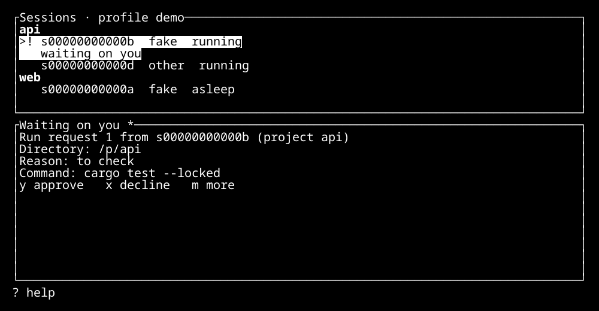

# Quickstart

This page takes you from an installed Torlek to your first agent session in about five minutes.
It assumes `torlek init` has nothing left but your first project and first session.
If not, follow the [README](../README.md) first.

## What Torlek does for you

- **Runs your coding agents side by side.** Claude Code, Codex or OpenCode, each in its own terminal session.
  You see them all in one list and open the one you want.
- **Runs agents with your rights by default.** The sandbox is off unless you turn it on, so an agent can do what you can and Torlek's grants do not bind it.
  Keep your work in Git. With `desktop_session = "withheld"` in your config, an agent stays away from your screen and desktop session.
  The [known gaps](KNOWN-GAPS.md) list what is still open.
- **Lets an agent ask you to run a command.** The agent sends you a request.
  The command runs only if you say yes.
- **Keeps a todo list per project.** You and your agents add items; agents can also suggest ideas, which you accept or decline.

## Your first project

A project is a Git repository you want agents to work in.
This example makes a new empty one:

```sh
mkdir -p "$HOME/torlek-example"
git -C "$HOME/torlek-example" init
torlek project add "$HOME/torlek-example" --name example
torlek project list
```

For your own work, give `torlek project add` the top folder of an existing repository instead.

## Your first session

A session is one agent working in one project.
Start one, then open the Torlek screen:

```sh
torlek session new "$HOME/torlek-example" --agent claude --prompt 'Describe this repository without changing files.'
torlek tui
```

Use `codex` or `opencode` instead of `claude` if that is the agent you use.
`torlek provider list` shows the names you can use.

In the Torlek screen:

- `j` and `k` (or the arrow keys) move through your sessions. `Enter` opens one.
- `N` starts a new session. `T` opens the todo list.
- `?` shows every key. `Esc` closes it.
- To leave the screen and keep everything running, press `Ctrl+b`, then `d`.

From a terminal, `torlek session list` shows your sessions, `torlek session show ID` opens one and `torlek session end ID` stops it.
Replace `ID` with the identifier from `session list`.



This picture uses made-up projects and agents.

## Approving a request

When an agent asks you to run a command, the request appears in the approval pane at the bottom of the Torlek screen.

1. Press `Tab` to move to the pane. Keys are ignored for a moment after a request appears or the pane gets focus, so read first.
2. Read the command, the folder it runs in and the agent's reason. Press `m` to see a long command in full.
3. Press `y` to run it once, or `x` to decline.

The command runs once, with your rights. If the request changes after you read it, you are asked again.

You can do the same from a terminal:

```sh
torlek approval list
torlek approval show ID
torlek approval decline ID
```

`torlek approval show ID` prints the exact approve command to use, with the version of the request you read.
The [user guide](USER-GUIDE.md#approvals) covers network requests and the rest of approvals.

## Getting help

- `torlek doctor` checks your setup and says what to fix next.
- `torlek --help` lists every command.
- `torlek bug-report new 'What went wrong' --steps 'How to make it happen again'` writes a bug report on your computer.
  `torlek bug-report show ID` shows what it contains. `torlek bug-report send ID` opens it as a GitHub issue in your browser, for you to check and submit.
  Nothing is sent without you.
- The [user guide](USER-GUIDE.md) has the details. Questions and problems go to [GitHub issues](https://github.com/Androlax2/agent-cockpit/issues).

## Let your agent explain it to you

Start a session, open it, and paste this into the agent:

```text
I am new to Torlek, the program that runs you in this session. Explain it to me.

- Use simple words and short sentences. One idea at a time.
- After each idea, ask me one question to check that I understood.
  Wait for my answer. If I got it wrong or I am unsure, explain it another way.
  If I already know it, move on faster.
- Cover, in this order: what Torlek is; projects and sessions; that you run
  with my rights unless I turn the sandbox on; how you ask me to run a command,
  and how I approve or decline; the todo list; how I get help when something breaks.
- Use the real Torlek commands on this machine instead of guessing:
  "torlek --help", "torlek docs", "torlek --skill" and "torlek doctor".
  Show me what a command printed when it helps. If a command is refused
  inside your session, say so and ask me to run it in my own terminal.
- Do not change anything: no files, no settings, no requests to run commands,
  unless I say yes first.
- Stop when I say I understand, and give me a three-line summary.
```
