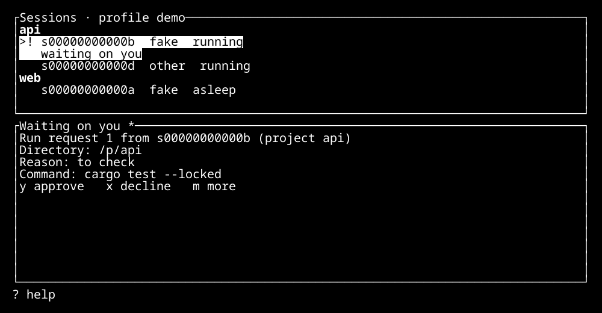

# Torlek user guide

The [README](../README.md) installs Torlek and the [quickstart](QUICKSTART.md) walks through a first session.
This guide is the detailed reference behind them.

Torlek runs your coding agents in terminal sessions and keeps their work, questions and approvals together.
One installation belongs to one person, with a CLI and terminal UI backed by a per-user daemon and tmux.
This release has no sandbox: agents run with your rights until Torlek's own sandbox ([#546](https://github.com/Androlax2/agent-cockpit/issues/546)) is live. You still decide which requests an agent asks you to run.

This is **Alpha 1 for Linux and WSL2**, built under `crates/` beside the running legacy product.
Alpha state may reset between releases; keep your work in Git and do not rely on alpha state migrating to beta.
Existing desktop users can find their commands and demo screenshots in the [legacy operator guide](legacy/README.md).

## Install status

Install a release archive as the [README](../README.md#install-from-the-command-line) shows.
Alpha 1 uses archive installation; other packaging (#563/#565) is deferred to Alpha 2. The Arch AUR recipe (#562) is prepared in Alpha 1 beside the archive, not as its prerequisite ([decision](decisions/2026-11-03-562-arch-packaging-alpha1.md), [recipe](packaging/aur.md)). macOS delivery and Homebrew are deferred beyond Alpha 1 under [#568](https://github.com/Androlax2/agent-cockpit/issues/568), with no restoration milestone assigned.
The root `make install` installs the legacy desktop setup; it is not the Alpha installer.

Developers can build the current greenfield binaries with the pinned Rust toolchain:

```sh
git clone https://github.com/Androlax2/agent-cockpit.git
cd agent-cockpit
cargo build --workspace --locked -j 2
export PATH="$PWD/target/debug:$PATH"
torlek doctor
```

See [Development](DEVELOPMENT.md) for build prerequisites and checks.
`doctor` names missing prerequisites and their next action; building alone does not sign in to a provider.
The steps below start once those prerequisites are ready.

## Platforms and prerequisites

| Platform | Target | Current evidence and limits |
| --- | --- | --- |
| Linux | Native | Linux CI runs the greenfield gate; public archive onboarding is an Alpha release checkpoint |
| macOS | Deferred beyond Alpha 1 | No Alpha 1 download, Homebrew package or macOS acceptance is promised. [#568](https://github.com/Androlax2/agent-cockpit/issues/568) tracks restoration, including unresolved [public CA isolation (#527)](https://github.com/Androlax2/agent-cockpit/issues/527); existing tests do not establish supported installation |
| Windows | Inside WSL2, from Windows Terminal | Linux backend inside WSL2; platform checks run in CI for selected crates; no native Windows daemon |

You need Git, tmux **3.6 or newer**, curl and a supported provider CLI.
Ubuntu 24.04 (including WSL2) ships tmux 3.4: upgrade tmux before using Torlek.
An existing private tmux server also needs the supported version; upgrading its binary alone does not replace it.
See [tmux prerequisites](DEVELOPMENT.md#tmux-prerequisite) for checks and upgrade guidance.
Linux/WSL2 service installation requires a systemd user manager.
Run `torlek doctor --project /absolute/path/to/project` to check the actual host and project requirements.
The platform checks are described in [Development](DEVELOPMENT.md#verification-policy); they do not establish a signed-in provider conversation on every platform.

## First project and session

Run these commands in your own terminal. For a source build, the default profile is `dev`; release bundles default to `torlek`.
`torlek config show` and `torlek doctor` show which profile and paths you are using.
Use the same profile throughout. To isolate a preview's state from an existing installation, use `torlek --profile next VERB` for every command, including `daemon install`.

1. Start the daemon and read the checklist:

   ```sh
   torlek daemon install
   torlek doctor
   torlek init
   ```

   `daemon install` writes and starts the daemon's user service.
   `init` writes nothing: it shows `done`, `todo`, `waits` or `unknown` and ends with the next action.
   Repeat it after completing that action. An `unknown` sign-in needs the manual check it names.

2. Open the owner configuration path printed by `torlek config show` and add the following settings, preserving any existing settings:

   ```toml
   [agents]
   sandbox = "off"
   desktop_session = "withheld"
   ```

   This records that you accept running agents unsandboxed, the only choice this release can run, and keeps agents off your desktop session.
   An unsandboxed agent runs with your rights: it can reach the owner socket and act as the owner, so Torlek's grants do not bind it. The daemon logs that risk at its start and at every launch.
   `sandbox = "required"` refuses every agent launch, naming the missing backend, until Torlek's own sandbox exists; it never runs an agent unsandboxed.
   A profile used with Torlek's removed Greywall and Greyproxy engines may still hold their `torlek-greyproxy-<profile>` service and state: `torlek doctor` lists them, and once no session an earlier release launched in Greywall still runs, `torlek doctor --remove-old-sandbox` stops the service and deletes them.
   The default desktop setting is `shared`, which exposes your display and filtered session bus to agents; choose it only if you want desktop access.
   Run `torlek config reload` after changing session settings on a running daemon.
   The TUI rings the terminal bell when a session finishes, asks a question or fails; add `[tui]` with `attention_bell = false` to turn that off, then close the manager session and run `torlek tui` again.

3. Choose a provider and follow `torlek init`'s sign-in instruction in your terminal:

   ```sh
   torlek provider list
   torlek init
   ```

   A local sign-in check does not prove your account has model access or remaining quota.
   Provider accounts and usage are managed by the provider.

4. Register a Git repository. This small example creates a new, empty project:

   ```sh
   mkdir -p "$HOME/torlek-example"
   git -C "$HOME/torlek-example" init
   torlek project add "$HOME/torlek-example" --name example
   torlek project list
   ```

   For existing work, pass the repository's top-level directory instead.

5. Start a session, choosing an installed provider name from the list:

   ```sh
   torlek session new "$HOME/torlek-example" --agent claude --prompt 'Describe this repository without changing files.'
   torlek session list
   torlek tui
   ```

   Replace `claude` with `codex` or `opencode` if that is your provider.
   For a Claude session, `--model MODEL` (an alias such as `opus` or a model id) and
   `--effort LEVEL` (`low`, `medium`, `high`, `xhigh` or `max`) choose its model and effort;
   every restart, wake and resume of the session keeps them. Without them, Claude Code's own
   settings apply. A provider that cannot set them refuses the start.
   In the TUI, use its help for available keys. From the CLI, `torlek session show ID` opens a session; replace `ID` with the identifier from `session list`.
   `torlek session end ID` stops it. `torlek init` shows when the first-session step is complete.



Alpha TUI, rendered from the checked-in demo fixture with fictional projects and agents.

On a terminal narrower than 60 columns, such as a phone over SSH, the TUI switches to a
one-column layout: requests and questions first, each with its whole command, then one line
per session. Enter opens a session full screen and read-only; `i` types a line into it, Esc
goes back. `[tui] phone_below_columns` in the owner configuration changes the width, and `0`
turns it off.

## Approvals

Inside a launched session, an agent can request a command it needs you to run with
`torlek ask run --reason 'why this needs the owner' 'command'`, or human steps with `torlek ask guide`.
A request does not authorize itself. Repository instructions and agent messages cannot grant host access.

Run owner commands (`approval`, `project add`, `session end`, `session grant`…) from your own terminal, not from an agent's pane: inside a session (Claude Code's `!` included) `torlek` sends every command on the agent socket, where they are refused.

Review requests in the TUI approval pane or in your terminal:

```sh
torlek approval list
torlek approval show ID
```

Read the exact command, directory, reason and content it runs. To approve, use
`torlek approval approve ID --revision REVISION --digest DIGEST` with the revision and digest shown by `approval show`.
An edit requires another review; stale approval details are refused.
Use `torlek approval decline ID` to decline. Approval runs that command once with the daemon's host rights.
Provider-native permission dialogs are separate and remain in the provider terminal.

### Network requests

Under `agents.sandbox = "required"`, a host no entry allows is refused at once (`403`) and becomes a request for you (#674).
It shows in the TUI approval pane and in `torlek approval list`; `torlek network list` lists only these:

```sh
torlek network list
torlek network allow ID            # for the rest of that session
torlek network allow ID --always   # for every session of the project, until revoked
torlek network deny ID             # refused at once from now on, without asking again
torlek network grants [PROJECT]
torlek network revoke GRANT        # closes the tunnels it carried
```

In the pane, `y` allows once, `a` allows always and `x` denies.
"Allow once" lasts the rest of the asking session, not one connection; a new session asks again.
"Allow always" covers only that host and port. Only names are asked about: IP addresses and names that resolve to private or loopback addresses stay refused.

## Phone status page

`torlek status serve` shows your sessions on your phone, read-only: each session's project, state, label, what it is doing and its open question (flagged), the approvals waiting for you (reason and age, never the command), the daemon's readiness with the low-disk guard, and when the page was generated, so a stalled daemon shows.
It refreshes itself every 15 s; `/status.json` returns the same data.
Nothing on it approves, answers or changes anything: decide from the TUI or your terminal.
What agents wrote (label, doing, question, reason) shows as written, so whatever they put in it shows too.
It is an owner verb: a session cannot start it, but it has no login: any process on this machine and anyone you share it with on your tailnet can read it.

It listens on `127.0.0.1` only (port 8850 unless you pass `--port N`). Reach it from your phone through [Tailscale Serve](https://tailscale.com/kb/1242/tailscale-serve), which keeps it inside your tailnet over HTTPS:

1. Run `tailscale serve status` to read your machine's tailnet name, such as `box.tailnet.ts.net`.
2. Start the page with that name: `torlek status serve --host box.tailnet.ts.net`.
3. In another terminal, run `tailscale serve --bg --https=443 http://127.0.0.1:8850`.
4. On your phone, with Tailscale connected, open `https://box.tailnet.ts.net/`.

The page refuses any request whose `Host` is not `127.0.0.1:PORT`, `localhost:PORT` or the `--host` name (bare or with `:443`), which blocks DNS rebinding. Tailscale Serve forwards your phone's `Host` unchanged, hence `--host`; it takes one exact name, no wildcard.
Never expose the page with `tailscale funnel`, which publishes it to the internet. Stop sharing it with `tailscale serve --https=443 http://127.0.0.1:8850 off`.

## Providers and capability evidence

`torlek provider list` shows installed provider names and whether each offers resume and events.
These capabilities depend on the release's hook/plugin bridges being present.
The following table describes the adapters in this checkout, not a promise that every installed provider version or account works.

| Provider name | Adapter capabilities with its bridge | Capability pin and provenance |
| --- | --- | --- |
| `claude` (Claude Code) | Resume, events/outcomes, submit/cancel, effort, compact, remote control, screen fallback | [2.1.316 adapter and fixture evidence](../crates/cockpit-claude/README.md) |
| `codex` (Codex) | Resume, events/outcomes, submit/cancel through a private app-server | [0.161.0 capability pin](../crates/cockpit-codex/README.md); local sign-in has a separate 0.166.0 conformance pin |
| `opencode` (OpenCode) | Resume, events/outcomes, submit/cancel, native commands | [1.19.5 adapter and fixture evidence](../crates/cockpit-opencode/README.md); sign-in remains discovered/unverified |

Adapters label a capability `tested` only at their exact capability pin; other or unknown versions are `discovered` (unverified).
Fixture tests and help/flag checks do not establish a live signed-in end-to-end conversation.
Codex delivered-turn approval routing has local fake-model evidence on 0.166.0; signed-in acceptance, the older 0.161.0 target and in-session resume/fork remain unmeasured. See its adapter's known gaps.
Receiving a prompt is not evidence that an agent completed its task.

## Configuration and state

`torlek config show` works without the daemon and prints effective values with their sources.
`torlek config show --project /absolute/path/to/project` includes project settings.
Owner configuration grants policy inputs; a repository's `.torlek/config.toml` describes workflow, checks and requirements and cannot grant owner permissions.
Unknown keys fail with the file and line. See the [current configuration guide](../crates/cockpit-config/README.md) for supported settings and precedence.

| Data | Default profile location |
| --- | --- |
| Owner settings | `~/.config/torlek/config.toml` |
| A project's GitHub token, its unsandboxed sessions' `GH_TOKEN` | `~/.config/torlek/github-tokens/<project>` |
| A project's GitHub API token, which the session proxy adds for sandboxed sessions | `~/.config/torlek/github-api-tokens/<project>` |
| Database, session records and instruction bundle | `~/.local/state/torlek/` |
| Torlek operational logs | `~/.local/state/torlek/logs/` |
| Each session's temporary files (its `TMPDIR`), removed when the session ends | `~/.local/state/torlek/tmp/<session>/` |
| Cache | `~/.cache/torlek/` |
| Update choices and the last release check (`update.json`) | `~/.local/state/torlek/` |
| Sockets and instance lock | `$XDG_RUNTIME_DIR/torlek/`, or the state directory's `run/` when unset |

`torlek storage` lists each session's temporary folder and its size.

To let a project's agents push and open pull requests without your own `gh` login, create a
fine-grained token limited to that repository (contents and pull requests: read and write)
and save it alone in `~/.config/torlek/github-tokens/<project>` (`mkdir -p -m 700` the
folder, then `chmod 600` the file).
Its next sessions get it as `GH_TOKEN`; a sandbox would hide your `~/.config/gh` login from them, but this release runs agents unsandboxed, so they can read it.
A project without one gets no `GH_TOKEN`. `torlek project show PROJECT` says which, never the
token. A file whose mode is not `0600` or `0400`, or one that holds anything but the token, stops the
project's sessions from launching until you fix it.

Under `agents.sandbox = "required"` no session gets that token: it can push, and pushes go
through `torlek push`. Save a second token for the project in
`~/.config/torlek/github-api-tokens/<project>`, same rules, with pull requests and issues
read and write and contents read only. The session proxy adds it on `api.github.com`, and on
`github.com` for fetches; the agent holds a placeholder `GH_TOKEN` and trusts a per-session
CA through `SSL_CERT_FILE` and its siblings. It is added only on the GitHub hosts the session
reaches at launch, including one you allowed for the project (`torlek network allow ID
--always`) or for the session; a host first allowed while the session runs gets it at the
session's next launch.
`torlek session sandbox SESSION` names any host it is not added on.

`XDG_CONFIG_HOME`, `XDG_STATE_HOME` and `XDG_CACHE_HOME` override their respective base directories.
Named profiles replace the `torlek` directory component with `torlek-NAME` (for example `torlek-dev`).
Use the paths printed by your binary; keep private state and provider credentials out of Git and support messages.

## Updates

Torlek tells you when a newer release is available. It never downloads, installs, restarts the daemon or stops a session for you: it prints the commands, and you run them.

- **When it checks.** At most once a day, when you run `torlek doctor` or `torlek session list` in a terminal, with a 3 second limit and the answer cached. Offline, rate-limited or failed checks print nothing and are not retried until the next day. Piped output, scripts and agent sessions never check or print a notice. A notice appears at most once a day.
- **What it offers.** The newest release of your channel or the next one (an alpha installation is offered the next beta; a beta installation is never offered an alpha), never an older one, a draft, or a release without an archive for your platform. A build that is not from a release archive has nothing to compare.
- **Your choices**, kept in `update.json` in the state directory:

  | Command | Effect |
  | --- | --- |
  | `torlek update` | Shows the cached release, its notes and the commands to update. Changes nothing. |
  | `torlek update later` | No reminders for 3 days. |
  | `torlek update skip` | No reminders about the offered version; a newer release is announced again. |
  | `torlek update checks off` / `on` | Turns automatic checks off or on. |
  | `torlek update check` | Asks the release list now, even with checks off. |

- **The update route.** For an installation unpacked as the README shows, `torlek update` prints the README's download, checksum and unpack commands for the new version, then `torlek daemon install`, which replaces the running daemon (stop, then start) while agent sessions keep running. Alpha releases may reset your data: read the release notes first.
- **Not supported yet.** An installation that is not a release archive unpacked in `~/.local/lib/torlek` as the README shows (a distribution package once #562, #563 and #565 publish them, an archive unpacked elsewhere, or a build from source) is told so, with no commands: update it the way you installed it. There is no macOS build (#568). The check needs `curl`, which the install route needs as well.

## Help and support

Start with `torlek doctor`, `torlek version --all` and `torlek init`.
The [CLI guide](../crates/cockpit-cli/README.md) lists current verbs.
`torlek docs` lists the installed agent instruction topics; `torlek docs TOPIC` reads one and `torlek --skill` prints the full agent manual through the daemon.
The [latest published user guide](https://androlax2.github.io/agent-cockpit/latest/) includes generated CLI help and effective configuration defaults, with source and binary provenance.
The generated protocol schema is still planned in [#295](https://github.com/Androlax2/agent-cockpit/issues/295).

For a Torlek problem, create and inspect a local bug-report draft:

```sh
torlek bug-report new 'Describe what happened' --steps 'Describe how to reproduce it'
torlek bug-report list
torlek bug-report show ID
```

Each draft includes a support bundle. Inspect its listed contents before sharing it.
Torlek's diagnostic logs exclude hosted prompts, agent output, shell commands, credentials and environment values; your own description may still contain private details.
`torlek bug-report send ID` opens a prefilled GitHub issue in your browser; you review and submit it, then attach the bundle yourself.
Torlek cannot see that you submitted it, so the draft is listed as opened until you record its issue: in the TUI press `B`, select the draft and press Enter, or run `torlek bug-report send ID --filed ISSUE_URL`. The issue's number works in place of its URL.
Nothing is filed automatically. There is no standalone `torlek support-bundle` CLI verb yet.
If the daemon is unavailable, use [GitHub issues](https://github.com/Androlax2/agent-cockpit/issues) with your version, platform and reproduction steps, excluding secrets.
Report security problems through [Security](../SECURITY.md).

To contribute, read [Contributing](../CONTRIBUTING.md). Architecture proposals and decisions live in the [greenfield design reports](design/greenfield/README.md) and [decision records](decisions/README.md).
